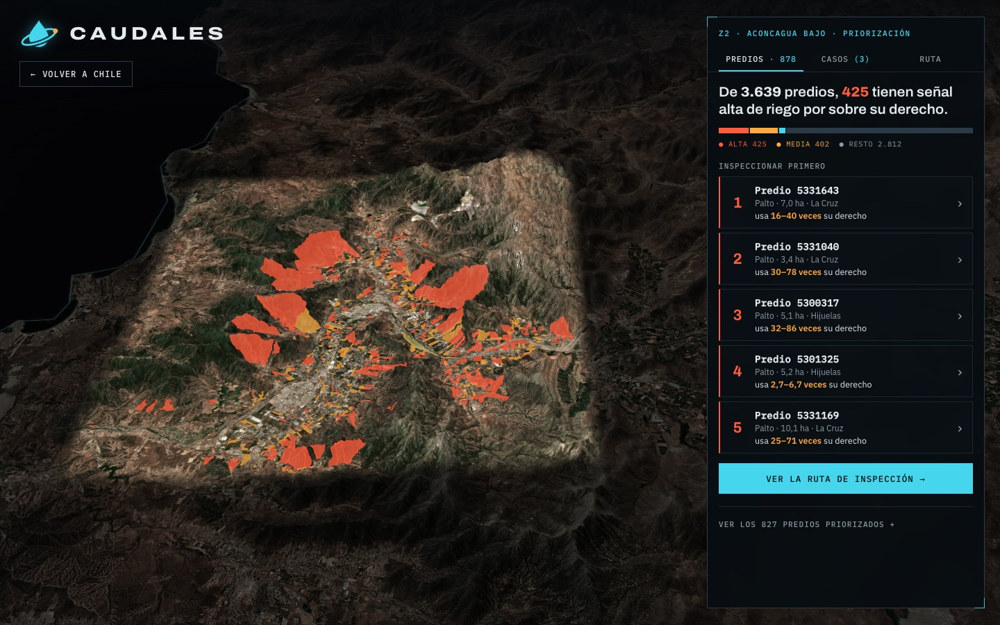
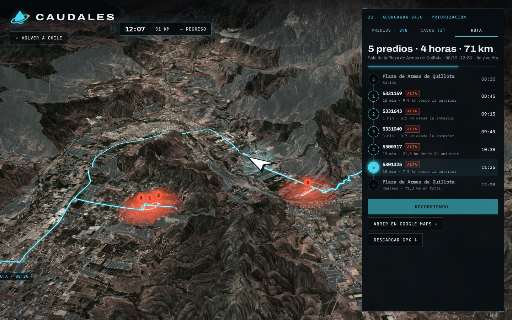
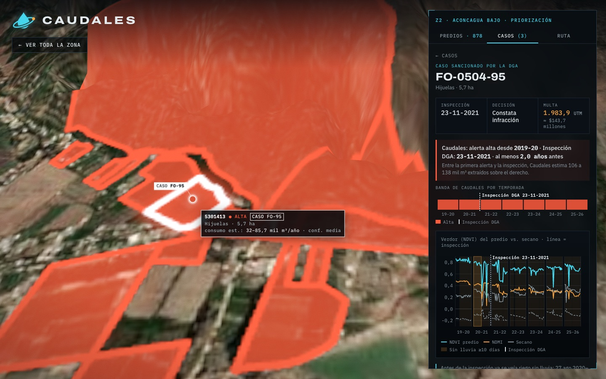
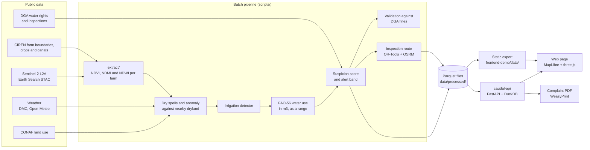

# Caudal

**Caudal finds, from free satellite images, farms that irrigate without the water rights to back it, and tells Chile's water authority which ones to inspect first.**

Built in 36 hours at Platanus Hack 26 (Santiago, November 2026), Physical World track, by team 15. The page and the submission use the name *Caudales*; the code and the docs say *Caudal*. Same project.

[](docs/img/screenshot-zone-ranking.jpg)

Live demo: <https://caudales.dev> (also <https://caudal-web-170658673954.southamerica-west1.run.app>). Both answered on 24 Nov 2026; they run on the team's hackathon cloud project and may be switched off.

> **Caudal ranks; it does not accuse.** Every output is an estimate, given as a range with its confidence, meant to decide where an inspector should go first. Only an inspection can establish an infraction. No owner names are stored or shown anywhere.

## The problem

In Petorca, 40,000 people have had to live on 50 litres of water a day, delivered by truck, while orchards in the same valleys stay green all summer, some with no water rights. The water authority (Dirección General de Aguas, DGA) has few inspectors for thousands of farms, and most cases start only when a neighbour files a complaint. Sources for these figures are in [project-description.md](project-description.md) and [docs/impacto.md](docs/impacto.md).

## What it does

Caudal covers 7,911 farms in two areas of the Valparaíso region: Petorca (Z1) and lower Aconcagua (Z2).

1. **Spots irrigation.** In a dry spell, a farm that stays greener and wetter than the dry hills next to it is being watered.
2. **Compares with water rights.** It estimates the water the crop needs (FAO-56) and compares it with the rights registered on that farm.
3. **Ranks the farms** into alert bands and plans a one-day inspection route.
4. **Prepares the complaint file.** A PDF with the fields of the DGA's complaint form, for a person to review, sign and file.

| Inspection route, played back over the terrain | A case the DGA had already fined |
| --- | --- |
|  |  |

## How it works



- **Precomputed in batch:** satellite series, irrigation signal, water use, score, route. Nothing satellite-related is recomputed when you open a farm.
- **Computed on request:** the API queries the Parquet files, writes the "why is this farm on alert" text from the farm's rows, and builds the complaint PDF.
- **No language model.** The explanation text and the PDF are rule-based templates over the data ([scripts/models/explicacion.py](scripts/models/explicacion.py), [scripts/models/expediente.py](scripts/models/expediente.py)).
- **The page works without the API.** It falls back to a static export of the API responses committed under `frontend-demo/data/respaldo/`.

More detail: [docs/en-vivo-y-precalculado.md](docs/en-vivo-y-precalculado.md) (what is live and what is precomputed), [data/README.md](data/README.md) (every dataset and model step), [docs/spec-v2.md](docs/spec-v2.md) (design). Most of the documentation is in Spanish.

## Does it work?

The team checked the score against farms the DGA had already inspected. Full method and caveats in [docs/validacion.md](docs/validacion.md).

- One farm in Hijuelas was inspected by the DGA in November 2021 and fined 1,983.9 UTM. Caudal has it on high alert from the 2019-20 season, the first one analysed.
- Starting from the farms Caudal flags, an inspector would find 2.6 times more infractions than picking farms at random (95% interval 1.3 to 4.4). This rests on 19 cases, so the interval is wide.
- Among farms the DGA already chose to inspect, the score does not separate infractors well (AUC 0.62, interval 0.46 to 0.77).

## Stack

- **Pipeline:** Python, pystac-client, rasterio, geopandas, DuckDB, Parquet, OR-Tools, scikit-learn.
- **API:** FastAPI, DuckDB over Parquet (no database), WeasyPrint and Jinja2 for the PDF.
- **Page:** plain HTML, CSS and ES modules with no build step; MapLibre GL for the Chile map, three.js for the 3D terrain scenes, a service worker for offline replay.
- **Cloud:** Google Cloud Run (API, page and batch jobs), Cloud Storage, Terraform.

## Repository

| Path | What it is |
| --- | --- |
| `scripts/extract/` | Downloads and joins the public data: farms, water rights, inspections, crops, canals, weather, satellite series |
| `scripts/models/` | Dry spells, anomalies, irrigation detector, water use, score, validation, calibration, impact, route, complaint PDF |
| `api/` | `caudal-api`: FastAPI with DuckDB over the Parquet files. [api/README.md](api/README.md) |
| `frontend-demo/` | The page, static, served with nginx in production. [frontend-demo/README.md](frontend-demo/README.md) |
| `data/` | Processed data and its documentation. [data/README.md](data/README.md) |
| `docs/` | Specs, validation, calibration, impact and the pitch |
| `infra/`, `scripts/cloud/`, `scripts/gcp/` | Terraform and helper scripts for the team's GCP project |

## Run it locally

You need Python 3.12 or newer and [uv](https://docs.astral.sh/uv/). No API keys, accounts or build step. Internet is needed for the map libraries, fonts and high-zoom imagery, which load from public CDNs.

```bash
git clone https://github.com/Phiripp/ph26.git caudal && cd caudal

# 1. API on port 8080 (the page looks for it there when opened on localhost)
uv run --with-requirements api/requirements.txt uvicorn api.main:app --port 8080

# 2. Page, in another terminal
cd frontend-demo && python3 -m http.server 8000
```

Open <http://localhost:8000>. Useful direct links: `/#z1` (Petorca), `/#z2` (lower Aconcagua), `/#caso-FO-0504-95` (a fined case), and `?demo=1` to hide the property number on fined cases.

Checked on macOS on 24 Nov 2026, with these notes:

- The first start of the API takes one to two minutes (dependency install, then loading the cases). `curl localhost:8080/api/health` answers when it is ready. Interactive docs at <http://localhost:8080/docs>.
- Step 1 is optional. Without the API the page uses the static export in `frontend-demo/data/respaldo/`, which covers the demo walkthrough.
- `data/processed/predio.parquet` (the full CIREN farm layer) is not in git. Without it the API still serves rankings, farm files and series, but has no polygons and cannot build a new PDF. Regenerate it with `uv run scripts/extract/predios_ciren.py`.
- Building a PDF also needs pango for WeasyPrint (`brew install pango` on macOS). The Docker image in `api/Dockerfile` already has it; see [api/README.md](api/README.md).
- The page registers a service worker on `localhost:8000`. Open it once with `?sw=0` to remove it if you reuse that port for something else.

Environment variables are optional and listed in [.env.example](.env.example). The only credentials in the project are for two weather sources used by the batch pipeline (DMC and the Copernicus Climate Data Store); the page and the API need none.

## Known limitations

- **It sees irrigation, not the source of the water.** Canal water held as shares is not in the rights registry, so a farm next to a canal can be legal and still be flagged. Those farms carry a warning, and 66% of the unvisited candidates have a canal within 300 m.
- **Estimates, not measurements.** Water use is a FAO-56 estimate given as a minimum, central and maximum value. The join between rights and farms is spatial and has its own confidence level.
- **Small validation set.** 19 detectable positive cases. The thresholds were later tuned on that same set, which makes the tuned figure (3.7 times) optimistic; 2.6 times is the figure with the thresholds fixed beforehand.
- **Greenness does not catch everything.** 14 of 33 fined cases had no detectable vegetation signal.
- **Two validated areas.** The run over the rest of Chile exposed under `/api/chile` is exploratory.
- **Hackathon code.** No automated tests, comments and docs mostly in Spanish, cloud scripts tied to the team's GCP project, and an API without authentication or rate limiting.
- **Snapshot.** The ranking is for the 2025-26 season; the last image used is from 28 March 2026.

## Data sources

All inputs are public. Licences are listed only as far as this repository documents them; check each provider's terms before reusing the data.

| Data | Source | Notes in this repo |
| --- | --- | --- |
| Satellite imagery | Sentinel-2 L2A (Copernicus), through Element84 Earth Search | "Contains modified Copernicus Sentinel data" |
| Base map and relief | Sentinel-2 cloudless by EOX IT Services GmbH, AWS Terrain Tiles, Natural Earth, OpenStreetMap contributors | Attribution in [frontend-demo/README.md](frontend-demo/README.md#atribución) |
| Farm boundaries, fruit census, canals | CIREN, through IDE Minagri | No terms of use were found; the source is cited and the full layer is not redistributed, only a sample and simplified polygons of flagged farms |
| Water rights, inspections, streams, restriction areas | DGA public registries and spreadsheets | The inspection spreadsheet has no names; holder names from the rights registry are not committed |
| Land use (dryland reference) | CONAF | |
| Weather | DMC stations (free account), Open-Meteo, ERA5-Land through the Copernicus CDS (national run only; requires accepting its licence) | |
| Road routing | OSRM public server, results stored | |

The repository itself has no licence file, so the code is not licensed for reuse until the team adds one.

## Privacy

- No owner names or national ID numbers (RUT) are in the repository or in the API responses.
- The property number (*rol*) is shown on the page only for farms with a fine already issued by the DGA, which is public record. `?demo=1` hides it there too.
- The processed data does include the *rol* of every analysed farm next to its alert band (`data/processed/puntaje.parquet`), and the API returns it when asked with `?rol=1`. Treat that file as sensitive: a flag is a reason to inspect, not a finding.

## Team

Team 15, Platanus Hack 26: Santiago ft. Buk, Physical World track.

- Nicolás del Valle Ruiz ([nico-del-valle](https://github.com/nico-del-valle))
- Felipe Andrés Mellado Bórquez ([Phiripp](https://github.com/Phiripp))
- Tomás Rodrigo Morales Garcia ([tmorals](https://github.com/tmorals))
- Gabriela Acuña Benito ([gabiacuna](https://github.com/gabiacuna))

Going by the commit history, roughly: Felipe and Nicolás built the page (`frontend-demo/`); Tomás most of the models, the API and the pitch; Gabriela most of the data extraction, the cloud infrastructure and the national run.

This is a personal copy of the team repository, [platanus-hack/platanus-hack-26-cl-team-15](https://github.com/platanus-hack/platanus-hack-26-cl-team-15), which also keeps the hackathon submission files ([platanus-hack-project.jsonc](platanus-hack-project.jsonc), [project-description.md](project-description.md), `project-logo.png`).
